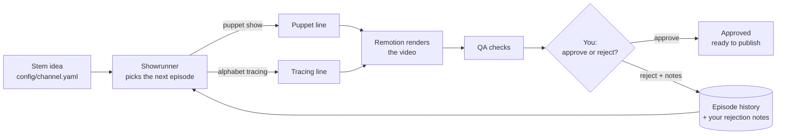
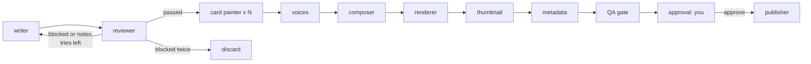
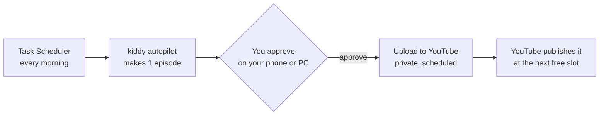

# How Kiddy works

Kiddy runs a kids' YouTube channel almost by itself. You set one **stem idea** once. From then on,
a team of AI agents invents each episode, writes it, paints it, voices it, animates it and checks
it. The only thing you do is **watch the finished video and approve or reject it**.

- **Part 1** explains how everything works today.
- **Part 2** explains how to make approved videos upload to YouTube automatically.

---

# Part 1: How everything works

## 1. The big picture



There are three layers:

| Layer | Language | What it does |
|---|---|---|
| **Agents** | Python + LangGraph (`src/kiddy/`) | Decide, write, check, paint, voice, time everything |
| **Renderer** | React + TypeScript + Remotion (`video/`) | Draws and animates the video frame by frame |
| **You** | Command line | Approve or reject finished videos |

The agents never draw anything themselves. They write a `props.json` file describing the whole
video (scenes, who says what and when, which pictures show up, how the mouths move). Remotion
turns that file into an MP4.

## 2. The daily workflow

```powershell
uv run kiddy autopilot --count 3   # invent and make 3 episodes, one after another
uv run kiddy review --open         # list what's waiting, and play the oldest
uv run kiddy approve <episode>     # keep it
uv run kiddy reject <episode> --notes "too much talking, more jokes"
```

That's all. You never type a topic.

### Every command

| Command | What it does |
|---|---|
| `kiddy autopilot --count N` | The showrunner invents N episodes and the agents make them. Each one stops at "awaiting approval". |
| `kiddy review [--open]` | Lists the videos waiting for you. `--open` plays the oldest one. |
| `kiddy approve <id>` | Approves a video and uploads it to YouTube (Part 2). |
| `kiddy reject <id> --notes "..."` | Rejects a video. Your notes are saved and **every future episode reads them**. |
| `kiddy auth youtube` | One-time YouTube sign-in (Part 2). |
| `kiddy schedule` | What's on YouTube, and when each video goes public. |
| `kiddy publish <id>` | Retries an upload that stopped, or finishes a missing thumbnail/captions/playlist. |
| `kiddy list` | Shows recent episodes and their status. |
| `kiddy resume <id>` | Continues an episode that stopped (crash, no internet, rate limit). Finished work is kept. |
| `kiddy trace [LETTER]` | Makes a tracing video by hand, without the showrunner. |
| `kiddy run` | The older "story with painted stills" format (kept, but not used by autopilot). |

Add `--fake` to `autopilot`, `trace` or `run` to make a complete video **offline and for free**
(placeholder pictures, silent voices, canned scripts). It's how the tests run.

## 3. The showrunner: where ideas come from

File: `src/kiddy/showrunner.py`, prompt: `src/kiddy/prompts/episode_planner.md`.

Each time autopilot needs an episode, the showrunner (Claude Haiku 5.5) gets:

- the **stem idea** (`concept` in `config/channel.yaml`)
- the **subject areas** (`curriculum`): letters, numbers, colors and shapes, feelings,
  healthy habits, animals, nature, science, seasons, safety, music, routines
- the **characters** (Fennel, Olo, Glim) and the two **formats**
- **every past episode** (format, subject, topic, status)
- the **letters already taught**
- **your rejection notes**

It answers with one `EpisodeIdea`: format, subject, topic, learning goal, letter (for tracing)
and one sentence on why it picked it. Code then double-checks the answer:

- **No repeats:** if the topic was already made, it asks again.
- **Tracing is a series, not the whole channel:** about 1 episode in 4 (`tracing_every`).
  If it picks a letter already done, the next free letter is used instead. **When A to Z is
  finished, tracing is removed from its options** and the channel simply carries on with puppet
  shows. It never "runs out": there's always a narrower topic ("how penguins keep warm").

## 4. Format 1: puppet shows

Files: `src/kiddy/puppet/` (agents) and `video/src/puppet/` (animation).



| Step | Who | What happens |
|---|---|---|
| **writer** | Claude Haiku 5.5 | Writes the show as scenes. Each scene has a stage (meadow, forest, pond, night, garden, home), a cast of 1 to 3 characters, and *beats*: `say` (a line), `act` (wave, jump, nod, point, dance, think, clap, spin), `move` (walk left/center/right), `card` (show a picture on the easel), `word` (a big word on screen). It reads your past rejection notes too. Code then removes anything the stage can't perform (unknown characters, empty lines, more than 5 cards). |
| **reviewer** | Groq gpt-oss-120b (free) | Checks every fact one by one (true / wrong / misleading), checks kid safety (no fear, nothing unsafe to copy, no brands, no "subscribe!"), scores age fit, clarity, warmth and so on. Code also **counts the words** (a 2 to 3 minute show needs about 180 to 280). Blocked or with notes: back to the writer (2 drafts max). Still blocked: the show is **discarded** and autopilot picks a fresh idea. You never see bad scripts. |
| **card painter** | Cloudflare FLUX.2 klein (free tier) | Paints each card picture (flat children's-book style). A vision model (Groq qwen) looks at it and asks for a redraw if it's wrong, has text in it, or looks creepy (up to 2 redraws, then it's flagged for you). |
| **voices** | Microsoft Edge voices (free) | One voice per character: Fennel is `en-US-AnaNeural`, Olo is `en-US-AndrewNeural`, Glim is `en-GB-MaisieNeural`. For every line it also measures the voice's loudness 30 times a second: that becomes **the mouth movement (lip sync)**. |
| **composer** | Code | Builds the timeline: lines play one after another at their real length, actions start with the next line, cards stay up until the next card or word. Writes `props.json`. |
| **renderer** | Remotion | Draws every frame (see below), then the sound is adjusted to YouTube's standard loudness (-14 LUFS, two passes). |
| **thumbnail** | Remotion | The first stage, the cast waving, the title, and the first card. |
| **metadata** | Code | Title (max 100 characters), description, tags. |
| **QA gate** | Code | Review passed, video rendered, every line voiced, every card painted and checked, thumbnail exists, title length OK. Failed checks don't stop the video: `kiddy review` lists them in its "warnings" column, so you know what to look at. |
| **approval** | You | The run pauses here (LangGraph `interrupt()`) until `kiddy approve` or `kiddy reject`. |

### How the puppets are animated

The puppets are React components drawn in SVG (`video/src/puppet/characters.tsx`). They aren't
images: they're made of parts (head, eyes, brows, mouth, arms, tail, wings), and every frame
`PuppetShow.tsx` works out each part's position:

- **Mouth:** opens with the loudness of the voice at that exact frame.
- **Eyes:** each puppet blinks on its own rhythm, and looks toward whoever is speaking.
- **Emotion:** each line has an emotion (happy, excited, curious, surprised, sad, calm) that
  changes the brows and the resting mouth.
- **Actions:** a wave raises an arm and shakes it, a jump squashes then lifts, a dance sways...
- **Idle life:** breathing sway, Fennel's tail swishes, Glim hovers and flaps.
- **Stages** (`backgrounds.tsx`) move a little too: clouds drift, stars twinkle, water ripples.

## 5. Format 2: alphabet tracing

Files: `src/kiddy/tracing/` and `video/src/AlphabetTracing.tsx`.

| Step | What happens |
|---|---|
| **planner** (Haiku) | Picks 3 words for the letter (apple, ant, alligator), each with a cheerful sentence. Code checks they really start with the letter. |
| **painter** | Paints the 3 word pictures (Cloudflare) with the same vision check. |
| **narrator** | Voices every line in Ana's voice. Most lines are templates ("This is a big letter A. Start at the green dot.") plus each stroke's instruction. |
| **composer** | Times each stroke to be drawn *while* its instruction is spoken. |
| **renderer, thumbnail, metadata, QA, approval** | Same as puppet shows. |

The letters themselves come from `src/kiddy/tracing/letters.json`: all 52 letters (A-Z, a-z)
as single-line strokes in classroom writing order, each with a spoken instruction. No AI draws
the letters, so they're always correct. Preview them all with:

```powershell
cd video; npx remotion still src/index.ts LetterSheet sheet.png
```

The video: title card, the big letter traced stroke by stroke (green numbered start dots, a crayon
drawing on writing lines), "your turn" practice, the small letter, three word cards, "Great job!".

## 6. Models, costs and free limits

| Job | Model / service | Cost |
|---|---|---|
| Showrunner, puppet writer, letter planner | Claude Haiku 5.5 (`effort: low`) | $0.10 / $0.50 per million tokens: about 25,000 tokens per puppet show, **well under 1 cent** |
| Script reviewer | Groq `openai/gpt-oss-120b` | Free tier |
| Picture check | Groq `qwen/qwen3.8-27b` | Free tier, queued at 2.5 checks a minute |
| Pictures | Cloudflare Workers AI, FLUX.2 klein 4B | Free: 10,000 neurons a day, about 170 pictures |
| Voices | Microsoft Edge voices | Free, no key (an unofficial service: swap it in one config line if needed) |
| Rendering | Remotion on your PC | Free for individuals and companies of up to 3 people |

Every model is set in `config/channel.yaml` under `llm:` and can be changed without touching
code. Groq's free models change often: if one disappears, pick another from the Groq console.

## 7. Never paying twice, never losing work

- **Checkpoints:** after every step, LangGraph saves the run to `data/checkpoints.sqlite`.
  If anything stops it (crash, no internet, a daily limit), `kiddy resume <id>` continues from the
  last finished step.
- **Pay once:** every picture and voice file is written to a temporary name first, then renamed.
  A finished file is never made again, so a resume never re-buys a picture.
- **Rate limits:** each model has a shared queue, so parallel steps wait their turn instead of
  failing. Short "too many requests" errors are retried automatically.

## 8. Where everything lives

```text
Kiddy/
  config/channel.yaml     the stem idea, subjects, characters, voices, models, providers
  .env                    your keys (never committed)
  src/kiddy/
    showrunner.py         invents the next episode
    approval.py           the approve/reject pause, and the publisher (what to upload, when)
    youtube.py            YouTube sign-in, upload, thumbnail, captions, playlists, fake client
    puppet/               puppet-show agents, timeline (compose.py), graph
    tracing/              tracing agents, letters.json, timeline, graph
    providers/            Claude/Groq, Cloudflare pictures, Edge/Groq voices, fakes
    media/                audio helpers (lip sync), FFmpeg (loudness)
    prompts/              one Markdown system prompt per agent
    cli.py                the kiddy commands
  video/                  the Remotion project (React + TypeScript)
    src/puppet/           puppets, stages, PuppetShow, PuppetThumbnail
    src/AlphabetTracing.tsx, Board.tsx, Scenes.tsx, Thumbnail.tsx
  output/episodes/<id>/   one folder per episode: script.json or plan.json, review.json,
                          cards/ or images/, audio/, props.json, video.mp4, thumbnail.jpg,
                          metadata.json, qa_report.json, and after the upload captions.srt
                          and youtube.json
  data/kiddy.sqlite       the episodes table: topic, subject, format, status, your notes,
                          YouTube id and publish time
  secrets/                client_secret.json and youtube_token.json (never committed)
  tests/                  48 tests, all offline (fake models, providers and YouTube)
```

**Episode statuses:** `started` → `making` → `awaiting_approval` → `approved` or `rejected`,
then `scheduled` (on YouTube, goes public at its time) or `uploaded` (on YouTube, private).
A show the reviewer blocked twice becomes `discarded`.

## 9. Changing things yourself

| You want to... | Change |
|---|---|
| Change the channel's direction | `concept` and `curriculum` in `config/channel.yaml` |
| More or fewer tracing videos | `tracing_every` |
| Longer or shorter shows | `puppet_minutes` |
| Another voice | a character's `voice`, or `narrator_voice` (samples in `output/voice-samples/`) |
| Another picture style | `tracing.picture_style` |
| Teach the agents a lesson | just reject with notes: they read them every time |
| A new character | add it under `characters:` **and** draw it in `video/src/puppet/characters.tsx` |
| A new stage | add it in `video/src/puppet/backgrounds.tsx` and to the `Background` list in `src/kiddy/puppet/models.py` and `video/src/puppet/types.ts` |

To preview the animation live while editing React code: `cd video; npx remotion studio`.

## 10. When something goes wrong

| Message | Fix |
|---|---|
| `Missing in .env: ...` | Add that key to `.env`. |
| `model ... does not exist` (Groq) | Groq retired it: choose a new model in `config/channel.yaml`. |
| `Cloudflare refused the picture: ... limit` | The 10,000 free daily neurons are used up. `kiddy resume <id>` after 00:00 UTC. |
| `Stopped: ...` anything else | Fix it, then run the `kiddy resume ...` command it prints. |
| First render is slow | Remotion downloads its headless Chrome once (about 100 MB). |

---

# Part 2: Uploading to YouTube automatically

## 1. The goal



Approving becomes the only thing you do. The approve step uploads the video, its thumbnail and
captions, adds it to the right playlist, and schedules it for the next free publishing slot
(for example one video a day at 16:00).

This is **built**. Below is the one-time setup you do, then what the code does.

## 2. One-time setup (about 15 minutes, free)

1. **Google Cloud project:** go to https://console.cloud.google.com, create a project named
   `kiddy`. Any Google account can own it, even one that isn't the channel's: videos go to
   the channel of whoever signs in at step 6.
2. **Turn on the API:** "APIs & Services" > "Library" > **YouTube Data API v3** > Enable.
3. **OAuth consent screen** ("Google Auth Platform"):
   - User type: **External**. App name: Kiddy. Your email as support and developer contact.
   - Add yourself as a **test user**.
   - Then press **"Publish app" (In production)**. This matters: while an app is in
     *Testing*, Google's refresh tokens **expire after 7 days**, and the automation would silently
     stop every week. Unverified and in production is fine for your own channel: when you log in
     you'll see a "Google hasn't verified this app" screen once; click "Advanced" > "Continue".
4. **Credentials:** "Create credentials" > "OAuth client ID" > type **Desktop app**. Download the
   JSON and save it as `secrets/client_secret.json` in the project. (`secrets/` is already in
   `.gitignore`.)
5. **Verify your YouTube channel** at https://www.youtube.com/verify (phone number), signed in
   as the channel's account. Without it, YouTube refuses custom thumbnails.
6. **Run once:** `uv run kiddy auth youtube`. It opens your browser: choose **the channel's
   Google account** (not the one that owns the Cloud project), then the kids' channel if you're
   asked, then "Advanced" > "Go to Kiddy" > Continue. It saves a long-lived refresh token to
   `secrets/youtube_token.json` and prints the channel's name: check it's the right one (if not,
   run it again). After that, nothing asks you to log in again.

## 3. What the upload does

For every approved episode, the publisher will make these calls (YouTube Data API v3, current
quota costs):

| Step | API call | Quota |
|---|---|---|
| 1. Upload the video, title, description, tags and settings | `videos.insert`, resumable upload | Its own bucket: **100 uploads a day**, 1 each |
| 2. Set the thumbnail | `thumbnails.set` | 50 of 10,000 daily units |
| 3. Add captions (from the lines we already have) | `captions.insert` | 400 units |
| 4. Add it to the format's playlist ("Puppet shows", "Alphabet tracing") | `playlistItems.insert` | 50 units |

That's 500 units per video, so about 20 videos a day fit easily. One a day is nothing.

The settings sent with each upload:

| Field | Value | Why |
|---|---|---|
| `status.selfDeclaredMadeForKids` | `true`, always | Required by US law (COPPA) for child-directed videos. Getting this wrong can mean fines. |
| `status.privacyStatus` | `private` | Uploaded hidden first... |
| `status.publishAt` | the next free slot, e.g. `2026-10-27T16:00:00+01:00` | ...then YouTube publishes it by itself at that time. Only works while the video is private and was never public. |
| `status.containsSyntheticMedia` | `false` | This flag is for *realistic* altered or AI content (fake real people, real events). Cartoon puppets are clearly not real. Re-check YouTube's rule if the style ever becomes realistic. |
| `snippet.categoryId` | `27` (Education) | |
| `snippet.title` | max 100 characters | Our metadata step already enforces this. |
| `snippet.description` | max 5,000 bytes | |
| `snippet.tags` | max 500 characters in total | |
| `snippet.defaultLanguage` | `en` | |

## 4. Safety built into the upload

- **Never twice:** the YouTube video id is saved (in `youtube.json` and the episodes table) the
  moment the upload returns, and so is every later step. Running again, or resuming after a
  crash, only does the steps that are missing.
- **Retries:** the video goes up in 8 MB pieces; a piece that fails (network, YouTube 5xx, rate
  limit) is retried up to 5 times with backoff, instead of resending the whole file.
- **Only the video is a must:** if the thumbnail, captions or playlist fail (an unverified
  channel can't set thumbnails, for example), the video is still scheduled and the problem shows
  as a yellow "not done" line. `kiddy publish <id>` retries just those.
- **Quota:** when YouTube's daily quota runs out, it stops with a clear message; run
  `kiddy publish <id>` the next day (it resets at midnight Pacific time).
- **Fake videos never upload:** an episode made with `--fake` (placeholder pictures, silent
  voices) only ever goes to the fake YouTube client, even if you approve it.
- **The human gate stays:** nothing reaches YouTube without your approval. For a children's
  channel this protects you: YouTube's monetization rules (YPP) exclude "mass-produced,
  repetitive" content, and kids' videos get extra review.

## 5. Making it run every day

Windows Task Scheduler runs autopilot every morning. Setting it up changes your system, so I'll
only do it when you say so. In PowerShell:

```powershell
$action  = New-ScheduledTaskAction -Execute "C:\Users\ASUS\AppData\Local\Programs\Python\Python313\Scripts\uv.exe" `
           -Argument "run kiddy autopilot --count 1" -WorkingDirectory "C:\Users\ASUS\Desktop\Kiddy"
$trigger = New-ScheduledTaskTrigger -Daily -At 7am
Register-ScheduledTask -TaskName "Kiddy autopilot" -Action $action -Trigger $trigger
```

The PC has to be on (or asleep with wake timers allowed) at that time. Remove it any time with
`Unregister-ScheduledTask -TaskName "Kiddy autopilot"`.

Your day then looks like this: in the evening, `kiddy review --open`, watch, `kiddy approve`.
The video goes up as private and publishes itself at the next slot.

Later, approval could move to your phone (a tiny private web page or a Telegram message with
Approve / Reject buttons), so you never need the PC.

## 6. How it's built

- `src/kiddy/youtube.py`: the sign-in (`google-auth-oauthlib`), and the upload, thumbnail,
  captions and playlist calls (`google-api-python-client`), plus a fake client for `--fake`
  runs and tests.
- `src/kiddy/approval.py`, `publish()`: after you approve, it picks the next free publishing
  time, uploads, then does the thumbnail, captions (`captions.srt`, written from the lines in
  `props.json`) and playlist. The publisher step and `kiddy publish` both call it.
- `config/channel.yaml`, the `youtube:` section:

  ```yaml
  youtube:
    upload: true                  # false: approved videos just wait in output/
    publish_times: ["16:00"]      # this PC's clock, one video per time; [] = stay private
    captions: true                # 400 quota units each
    playlists: {puppet: Puppet shows, tracing: Alphabet tracing}   # made if missing
  ```

- A publishing time must be at least 1 hour away, so YouTube has time to process the video.
  Two approved videos never share a time: the second one gets the next day's slot.
- `kiddy approve` checks that you're signed in **before** approving, so an approval never gets
  stuck halfway.

## Sources

- YouTube quota costs: https://developers.google.com/youtube/v3/determine_quota_cost
- `videos.insert`: https://developers.google.com/youtube/v3/docs/videos/insert
- Video fields (status, snippet limits): https://developers.google.com/youtube/v3/docs/videos
- Refresh tokens expire after 7 days in Testing: https://developers.google.com/identity/protocols/oauth2
- Custom thumbnails need a verified account: https://support.google.com/youtube/answer/72431
