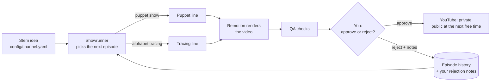
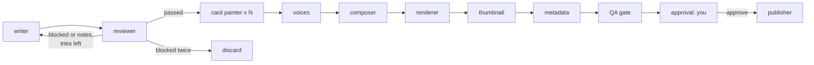
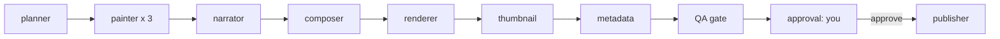
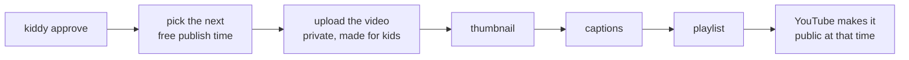

# Kiddy

AI agents that run a kids' YouTube channel on their own: they invent, write, voice and animate
puppet shows and alphabet-tracing videos, then upload them after one human approval.

You set one **stem idea** once. From then on, a team of AI agents invents each episode, writes
it, paints it, voices it, animates it and checks it. The only thing you do is **watch the
finished video and approve or reject it**. Approved videos go to YouTube and publish themselves.



**Contents:** [How the agents work](#how-the-agents-work) ·
[How the project is organised](#how-the-project-is-organised) ·
[Install and run](#install-and-run) · [Day-to-day use](#day-to-day-use) ·
[Uploading to YouTube](#uploading-to-youtube) · [Configuration](#configuration) ·
[Models and costs](#models-and-costs) · [Troubleshooting](#troubleshooting)

---

## How the agents work

Kiddy has three layers:

| Layer | Built with | What it does |
|---|---|---|
| **Agents** | Python, LangGraph, LangChain (`src/kiddy/`) | Decide, write, review, paint, voice and time everything |
| **Renderer** | React, TypeScript, Remotion (`video/`) | Draws and animates the video frame by frame |
| **You** | The `kiddy` command line | Approve or reject finished videos |

The agents never draw anything themselves. They write a `props.json` file that describes the
whole video: the scenes, who says what and when, which pictures appear, how the mouths move.
Remotion turns that file into an MP4.

Each production line is a LangGraph graph. Every agent is a node, and the run is saved after each
one, so a crash never loses finished work. Pictures are painted in parallel. The graph pauses at
the approval step until you answer.

### 1. The showrunner: where ideas come from

Each time autopilot needs an episode, the showrunner (Claude Haiku 5.5) is given:

- the **stem idea** and the **subjects** to rotate (letters, numbers, colors and shapes,
  feelings, healthy habits, animals, nature, science, seasons, safety, music, routines)
- the **characters** (Fennel the fox kit, Olo the tortoise, Glim the firefly) and the two
  **formats**
- **every past episode**, the **letters already taught**, and **your rejection notes**

It answers with one episode idea: format, subject, topic, learning goal, and a letter for tracing.
Code then double-checks it:

- **No repeats:** a topic that was already made is sent back.
- **Tracing is a series, not the whole channel:** about 1 episode in 4. When A to Z is finished,
  tracing drops out and the channel carries on with puppet shows. It never runs out of ideas,
  because there's always a narrower topic ("how penguins keep warm").

### 2. Puppet shows



| Step | Who | What happens |
|---|---|---|
| **writer** | Claude Haiku 5.5 | Writes the show as scenes. Each scene has a stage (meadow, forest, pond, night, garden, home), 1 to 3 characters, and *beats*: a line to say, an action (wave, jump, dance...), a move, a picture card or a big word on screen. It reads your past rejection notes. Code removes anything the stage can't perform. |
| **reviewer** | Groq gpt-oss-120b | Checks every fact, checks kid safety (no fear, nothing unsafe to copy, no brands), scores age fit and clarity, and counts the words for the target length. With problems, the show goes back to the writer (2 drafts max). Still blocked: it's **discarded** and a fresh idea is picked. You never see bad scripts. |
| **card painter** | Cloudflare FLUX.2 klein | Paints each picture card. A vision model (Groq qwen) looks at it and asks for a redraw if it's wrong, has text in it or looks creepy. After 2 redraws it's flagged for you. |
| **voices** | Microsoft Edge voices | One voice per character. It also measures each voice's loudness 30 times a second, and that drives the **lip sync**. |
| **composer** | Code | Builds the timeline: lines in order at their real length, actions with their lines, cards on screen until the next one. Writes `props.json`. |
| **renderer** | Remotion | Draws every frame, then sets the sound to YouTube's standard loudness (-14 LUFS). |
| **thumbnail** | Remotion | The stage, the cast waving, the title and the first card. |
| **metadata** | Code | Title (max 100 characters), description, tags. |
| **QA gate** | Code | Checks that everything exists and passed. Failed checks don't stop the video, they show up as warnings when you review it. |
| **approval** | You | The run pauses until you approve or reject. |

**How the puppets move:** they're React components drawn in SVG (`video/src/puppet/`), made of
parts: head, eyes, brows, mouth, arms, tail and wings. Every frame:
- The mouth follows the voice.
- The eyes blink and look at whoever is speaking.
- The brows show the line's emotion.
- Actions animate the arms and body.
- The puppets breathe, and the stages move a little (clouds drift, stars twinkle, water ripples).

### 3. Alphabet tracing



| Step | What happens |
|---|---|
| **planner** (Claude Haiku 5.5) | Picks 3 words for the letter (apple, ant, alligator), each with a cheerful sentence. Code checks they really start with that letter. |
| **painter** | Paints the 3 word pictures, with the same vision check. |
| **narrator** | Voices every line ("This is a big letter A. Start at the green dot."). |
| **composer** | Times each stroke so it's drawn *while* its instruction is spoken. |
| **the rest** | Same as puppet shows. |

The letters come from `src/kiddy/tracing/letters.json`: all 52 letters (A-Z and a-z) as strokes
in classroom writing order. No AI draws the letters, so they're always correct.

### 4. The publisher: approval to YouTube



- **Made for kids, always.** Every upload is marked "made for kids", as US law (COPPA) requires.
- **One video per time slot.** Each video goes public at the next free time in `publish_times`
  (for example 16:00 every day), at least 1 hour after the upload.
- **Never uploaded twice.** Every finished step is saved in the episode's `youtube.json`, so a
  retry only does what's missing.
- **Only the video has to succeed.** If the thumbnail, captions or playlist fail, the video still
  goes out and you get a warning. `kiddy publish <id>` retries them.
- **Test videos stay offline.** Videos made with `--fake` never reach YouTube.

### 5. Never paying twice, never losing work

- **Checkpoints:** LangGraph saves the run after every step (`data/checkpoints.sqlite`). If
  anything stops it, `kiddy resume <id>` continues from the last finished step.
- **Pay once:** a finished picture or voice file is never made again, so resuming never pays for
  the same picture twice.
- **Rate limits:** parallel steps share a queue per model, so they wait their turn instead of
  failing. Short "too many requests" errors are retried automatically.

---

## How the project is organised

```text
Kiddy/
  config/channel.yaml     the stem idea, subjects, characters, voices, models, YouTube settings
  .env                    your API keys (never committed)
  secrets/                YouTube sign-in files (never committed)
  src/kiddy/
    cli.py                the kiddy commands
    showrunner.py         invents the next episode
    approval.py           the approve/reject pause, and the publisher (what to upload, when)
    youtube.py            YouTube sign-in, upload, thumbnail, captions, playlists
    puppet/               puppet-show agents, timeline (compose.py), graph
    tracing/              tracing agents, letters.json, timeline, graph
    providers/            Claude/Groq models, Cloudflare pictures, Edge voices, and their fakes
    media/                audio helpers (lip sync), FFmpeg (loudness)
    prompts/              one Markdown system prompt per agent
  video/                  the Remotion project (React + TypeScript)
    src/puppet/           puppets, stages, PuppetShow, PuppetThumbnail
    src/AlphabetTracing.tsx and friends
  output/episodes/<id>/   one folder per episode: script, pictures, voices, props.json,
                          video.mp4, thumbnail.jpg, metadata.json, qa_report.json, youtube.json
  data/kiddy.sqlite       every episode: topic, format, status, your notes, YouTube id
  tests/                  offline tests (fake models, providers and YouTube)
```

**Episode statuses:** `started` → `awaiting_approval` → `approved` or `rejected` →
`scheduled` (on YouTube, goes public at its time) or `uploaded` (on YouTube, private). A show
the reviewer blocked twice becomes `discarded`.

---

## Install and run

### Requirements

- **Python 3.13+** and **[uv](https://docs.astral.sh/uv/)**
- **Node.js 20+** (for Remotion)
- FFmpeg comes with the Python packages. The first render downloads a headless Chrome (~100 MB).

### Install

```powershell
uv sync
cd video; npm install; cd ..
```

### Try it offline first (free, no keys)

```powershell
uv run kiddy autopilot --fake     # a complete video with placeholder pictures and silent voices
uv run kiddy trace B --fake       # an alphabet tracing video for B
```

### Add your keys

```powershell
copy .env.example .env
```

Then fill in `.env`:

| Key | Used for | Where to get it |
|---|---|---|
| `ANTHROPIC_API_KEY` | showrunner, writer, letter planner | https://console.anthropic.com/settings/keys |
| `GROQ_API_KEY` | script reviewer, picture check (free) | https://console.groq.com/keys |
| `CLOUDFLARE_ACCOUNT_ID`, `CLOUDFLARE_API_TOKEN` | pictures (free tier) | Cloudflare dashboard > Workers AI |

The voices (Microsoft Edge) need no key.

### Make your first real episode

```powershell
uv run kiddy autopilot          # invents and makes one episode
uv run kiddy review --open      # see it and play it
```

---

## Day-to-day use

```powershell
uv run kiddy autopilot --count 3   # invent and make 3 episodes
uv run kiddy review --open         # list what's waiting, and play the oldest
uv run kiddy approve <episode>     # upload it: it goes public at the next free time
uv run kiddy reject <episode> --notes "too much talking, more jokes"
```

You never type a topic. Rejection notes are saved, and **every future episode reads them**.

| Command | What it does |
|---|---|
| `kiddy autopilot --count N` | Invents and makes N episodes. Each one waits for your approval. |
| `kiddy review [--open]` | Lists videos waiting for you, with warnings. `--open` plays the oldest. |
| `kiddy approve <id>` | Approves a video and uploads it to YouTube. |
| `kiddy reject <id> --notes "..."` | Rejects a video, with notes for the next episodes. |
| `kiddy schedule` | What's on YouTube, and when each video goes public. |
| `kiddy publish <id>` | Retries an upload that stopped, or a missing thumbnail, captions or playlist. |
| `kiddy list` | Recent episodes and their status. |
| `kiddy resume <id>` | Continues an episode that stopped (crash, no internet, daily limit). |
| `kiddy trace [LETTER]` | Makes a tracing video by hand (empty: the next letter not made yet). |
| `kiddy auth youtube` | One-time YouTube sign-in. |
| `kiddy run` | The older "story with painted stills" format (not used by autopilot). |

Add `--fake` to `autopilot`, `trace` or `run` to work offline and for free.

### Make it run every day

Windows Task Scheduler can make one episode every morning. Run this once in PowerShell from the
project folder:

```powershell
$action  = New-ScheduledTaskAction -Execute (Get-Command uv).Source `
           -Argument "run kiddy autopilot --count 1" -WorkingDirectory (Get-Location)
$trigger = New-ScheduledTaskTrigger -Daily -At 7am
Register-ScheduledTask -TaskName "Kiddy autopilot" -Action $action -Trigger $trigger
```

Then in the evening: `kiddy review --open`, watch, `kiddy approve`. The PC must be on at 7:00.
Remove it with `Unregister-ScheduledTask -TaskName "Kiddy autopilot"`.

---

## Uploading to YouTube

One-time setup (about 15 minutes, free):

1. **Google Cloud project:** at https://console.cloud.google.com, create a project. Any Google
   account can own it: videos go to the channel of whoever signs in at step 6.
2. **Turn on the API:** APIs & Services > Library > **YouTube Data API v3** > Enable.
3. **Sign-in screen** (Google Auth Platform): user type **External**, add the channel's account as
   a test user, then click **Publish app**. While the app is in "Testing", the sign-in expires
   every 7 days.
4. **Credentials:** Create credentials > OAuth client ID > **Desktop app**. Download the JSON and
   save it as `secrets/client_secret.json`.
5. **Verify the channel** at https://www.youtube.com/verify, signed in as the channel's account.
   Custom thumbnails need it.
6. **Sign in once:**

   ```powershell
   uv run kiddy auth youtube
   ```

   Choose the channel's Google account. On "Google hasn't verified this app", click Advanced >
   Go to Kiddy > Continue. The command prints the channel's name, so check it's the right one.

After that, `kiddy approve` uploads by itself. Daily YouTube limits: 100 uploads, plus 10,000
quota units for the rest. Each video uses about 500 units (thumbnail 50, captions 400, playlist
50), so about 20 videos a day fit.

---

## Configuration

Everything lives in `config/channel.yaml`:

| You want to... | Change |
|---|---|
| Change the channel's direction | `concept` (the stem idea) and `curriculum` |
| More or fewer tracing videos | `tracing_every` |
| Longer or shorter shows | `puppet_minutes` |
| Another voice | a character's `voice`, or `narrator_voice` |
| Another model for an agent | its line under `llm:` |
| When videos go public | `youtube.publish_times`, e.g. `["09:00", "16:00"]` |
| Upload or not | `youtube.upload` (`false`: approved videos stay in `output/`) |
| Teach the agents a lesson | reject with notes: they read them every time |
| A new character | add it under `characters:` **and** draw it in `video/src/puppet/characters.tsx` |

To preview the animation while editing the React code: `cd video; npx remotion studio`.

---

## Models and costs

| Job | Model or service | Cost |
|---|---|---|
| Showrunner, puppet writer, letter planner | Claude Haiku 5.5 (`effort: low`) | about 25,000 tokens a puppet show: **under 1 cent** |
| Script reviewer | Groq `openai/gpt-oss-120b` | free tier |
| Picture check | Groq `qwen/qwen3.8-27b` | free tier |
| Pictures | Cloudflare Workers AI, FLUX.2 klein | free: about 170 pictures a day |
| Voices | Microsoft Edge voices | free, no key |
| Rendering | Remotion on your PC | free for individuals and teams of up to 3 |
| Uploading | YouTube Data API v3 | free |

---

## Troubleshooting

| Message | Fix |
|---|---|
| `Missing in .env: ...` | Add that key to `.env`, or try `--fake`. |
| `model ... does not exist` (Groq) | Groq retired it: pick another in `config/channel.yaml` under `llm:`. |
| `Cloudflare refused the picture: ... limit` | The free daily pictures are used up. `kiddy resume <id>` after 00:00 UTC. |
| `Not signed in to YouTube yet` | Run `uv run kiddy auth youtube`. |
| `YouTube's daily quota is used up` | Run `kiddy publish <id>` tomorrow (it resets at midnight Pacific time). |
| `Stopped: ...` anything else | Fix it, then run the `kiddy resume ...` command it prints. |

## Tests

```powershell
uv run pytest        # all offline: fake models, pictures, voices and YouTube
uv run ruff check src tests
```
